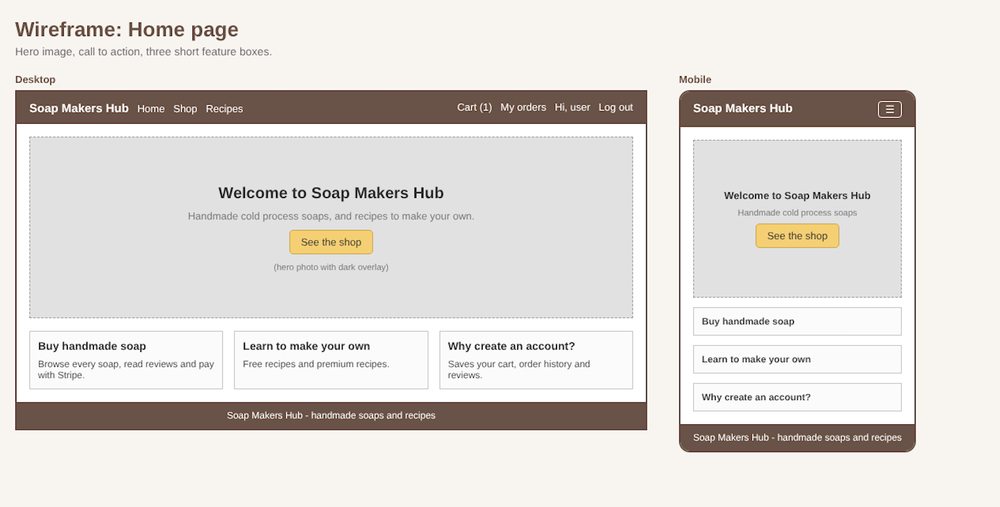
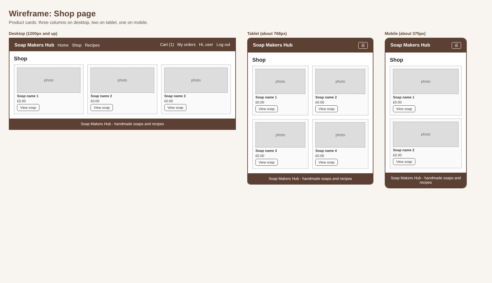
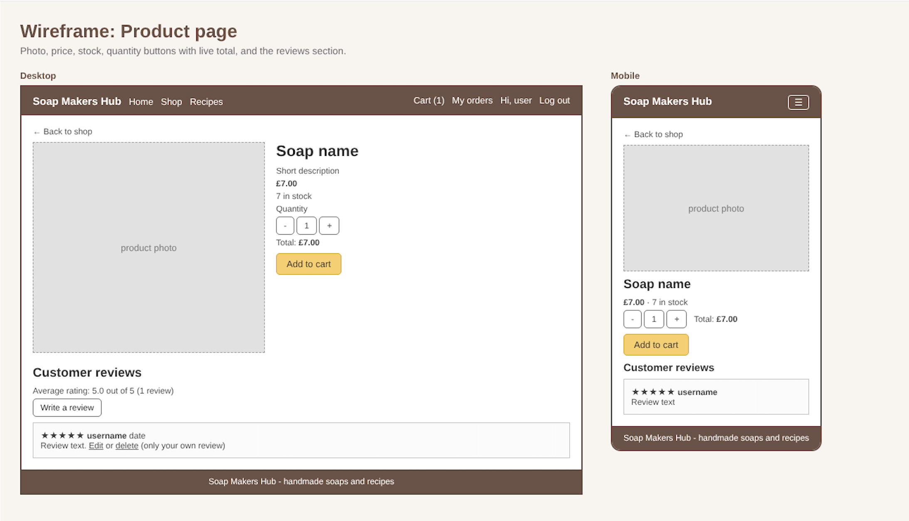
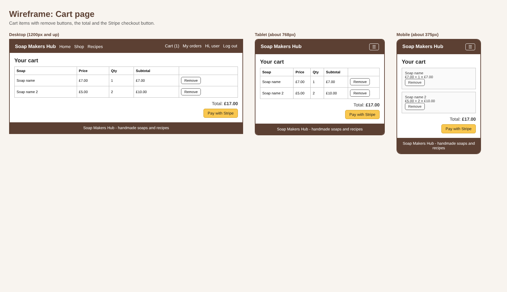
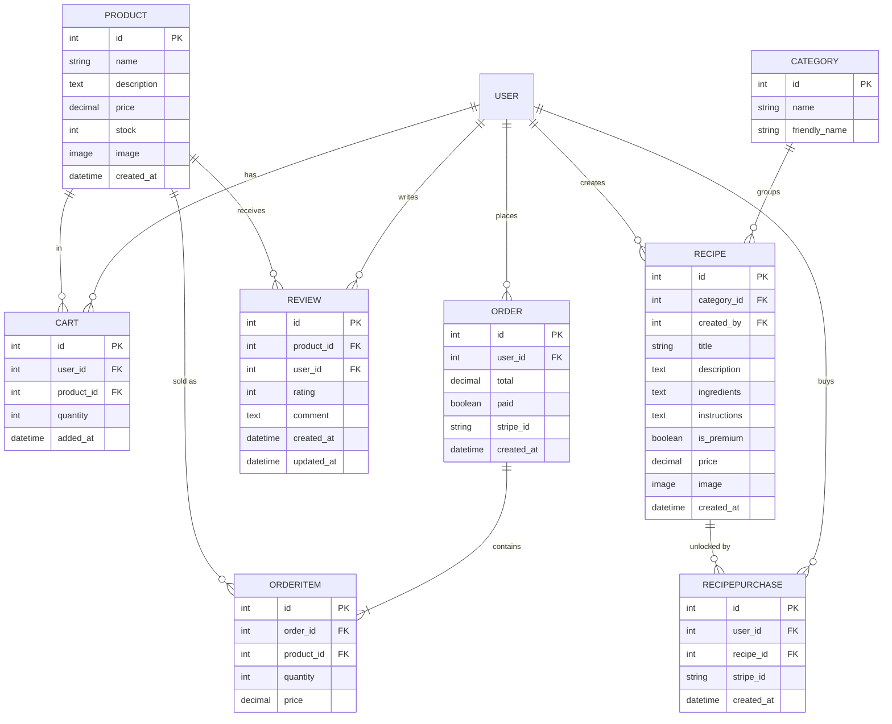

# Soap Makers Hub

Soap Makers Hub is a Django website where people can buy handmade cold process soaps and read soap-making recipes. Some recipes are free and some are premium, which a customer unlocks with a one-off payment. Customers pay securely with Stripe, can leave one review per soap, and can see their own order history.

**Live site:** https://soap-makers-hub.onrender.com

**Repository:** https://github.com/JackelineBDM/soap-makers-hub

This is my Milestone Project 4 for the Gateway Level 5 Diploma, Unit 4.

The live site runs on Render's free plan, so the first page can take up to a minute to wake up.

## Contents

1. [Purpose and audience](#purpose-and-audience)
2. [User stories](#user-stories)
3. [Design](#design)
4. [Features](#features)
5. [Database design](#database-design)
6. [Technologies](#technologies)
7. [Testing](#testing)
8. [Deployment](#deployment)
9. [Run it locally](#run-it-locally)
10. [Future improvements](#future-improvements)
11. [Credits](#credits)

## Purpose and audience

The site is for two kinds of visitor:

- People who want to buy handmade soap online.
- People who want to learn how to make soap themselves.

A shop on its own is easy to forget, so the recipes give visitors a reason to come back. Premium recipes also give the owner a second way to earn money.

**Why a visitor should register:** a free account keeps your cart between visits, keeps your order history, lets you review the soaps you bought, and ties any premium recipe you unlock to your account.

**Value for the owner:** the owner sells soap and sells premium recipes. A visitor cannot get a premium recipe's ingredients and method without paying, because the server checks with Stripe that the payment really happened.

## User stories

| As a... | I want to... | So that... |
| --- | --- | --- |
| Visitor | see all the soaps with photos and prices | I can decide what to buy |
| Visitor | read the free recipes | I can try soap making |
| Visitor | register and log in | my cart, orders and reviews are saved |
| Customer | choose a quantity and see the total change | I know what I am paying |
| Customer | pay by card with Stripe | my payment is safe |
| Customer | see my past orders | I can check what I bought |
| Customer | write, edit and delete my own review | I can share my opinion and fix mistakes |
| Customer | unlock a premium recipe | I can read its ingredients and steps |
| Customer | get clear messages and error pages | I always know what happened |
| Shop owner | add, edit and delete soaps, recipes and categories in the admin | I can run the shop without touching code |
| Shop owner | have one account unable to change another person's data | customers' data stays private |

Each story is tested one by one in [TESTING.md](TESTING.md#user-stories-tested).

## Design

I planned the design using the five planes of UX design: strategy, scope, structure, skeleton and surface. Each plane below says what I decided and why.

### UX design: the five planes

| Plane | What I decided | Why |
| --- | --- | --- |
| Strategy | Two audiences (soap buyers and people who want to learn soap making) and two owner goals (sell soap, earn from premium recipes). | A shop plus recipes gives visitors two reasons to visit, and gives the owner two ways to earn. |
| Scope | In: accounts, shop, cart, Stripe payment, order history, reviews, free and premium recipes, admin. Left for later: password reset by email, order emails, saved delivery addresses, search. | These are the features the user stories need. The later items need an email service, which I have not set up yet. |
| Structure | Main menu: Home, Shop, Recipes. Logged-out visitors also see Log in and Register. Logged-in customers see Cart (with an item count), My orders, their name and Log out. Main journey: Shop, then a soap page, then Cart, then Stripe payment, then My orders. Second journey: Recipes, then a recipe page, then unlock. | The menu stays the same on every page, so people always know where they are and how to get back. |
| Skeleton | Wireframes for the home, shop, product and cart pages at desktop, tablet and mobile sizes (see below). On small screens the menu collapses behind a menu button and the product cards move to one column. | A phone user needs large, simple controls and no sideways scrolling. |
| Surface | Warm brown (#5c4033) for the header and footer, a soft cream (#f8f4ef) background and yellow main buttons. Photos of real soaps are the main visual. | The look is calm and natural, which suits handmade soap. The yellow button always means the main action on a page. |

### How the design follows UX principles

| Principle | How the site follows it |
| --- | --- |
| Information hierarchy | Soap and recipe cards show the photo first, then the name, then the price. Premium recipes carry a clear badge with their price, and free recipes carry a Free badge. Pages use proper headings in order, which the W3C checker confirmed. |
| User control | Customers choose their own quantity with plus and minus buttons, can edit or delete their own reviews, and can remove items from the cart. Nothing plays or pops up by itself. A visitor who goes to a page that does not exist is sent to the site with a message, without needing the browser's back button. |
| Consistency | The same menu, footer, button style and message style appear on every page, and every action reports back in the same way. |
| Feedback and confirmation | Every action shows a message: review added, updated or deleted, form errors, and a declined card. The pay button switches to a busy message after one click, so a payment cannot be sent twice. |
| Accessibility | Page areas use header, main and footer, there is a skip-to-content link, headings follow the right order, and form errors are written in plain words. Lighthouse Accessibility scores are 95 on mobile and 100 on desktop. |

### Design decisions to note

- **Payment page:** the payment form is Stripe's own page, not one I built. That is deliberate. Card details never touch my server, which is safer than building my own form.
- **No password reset yet:** a visitor who forgets their password cannot reset it by email, because the site has no email service. This is listed under Future improvements.

### Wireframes

Wireframes for each main page, at desktop, tablet and mobile sizes:






## Features

**Accounts**
- Register, log in and log out with Django's built-in user system.
- Logged-in visitors are sent away from the login page.

**Shop**
- Soap list with photos and prices. Each soap has its own page with price, stock and quantity buttons.
- JavaScript (`static/js/product.js`) lets the plus and minus buttons change the quantity and updates the total straight away.
- Cart saved per user. Items can be added and removed, and the quantity is respected.

**Checkout and orders**
- Stripe Checkout takes the payment on Stripe's own page, so card details never touch my server.
- When Stripe returns to the site, the server asks Stripe whether the session was really paid before marking the order paid. Typing the success address by hand does not mark an order paid.
- A signed Stripe webhook (`/checkout/webhook/`) also marks the order paid, and the code is safe to run twice.
- A "My orders" page shows only the logged-in user's orders.
- `static/js/checkout.js` disables the pay button after one click, to avoid double payments.

**Reviews** (full create, read, update and delete)
- One review per customer per soap, with a 1 to 5 rating and a comment of at least 10 characters.
- Customers can only edit or delete their own reviews. Trying someone else's shows a "not allowed" page.

**Recipes**
- Free recipes are open to everyone. Premium recipes show a description and an unlock button, and the ingredients and steps appear only after payment.
- Recipes are grouped by category.

**Messages and errors**
- Success and error messages appear after every action.
- A friendly "not allowed" page (403) and a 404 handler that returns the visitor to the site with a message.

**Admin**
- The owner manages soaps, recipes, categories, recipe purchases, orders, carts and reviews in the Django admin.

## Database design

The site has 8 custom models and uses Django's built-in User.



How the models fit together:

- **Product** is the soap for sale. A product can appear in many carts, many order items and many reviews.
- **Cart** holds one soap and a quantity for one user. It is why a customer's cart is saved between visits.
- **Order** is one payment by one user. It has many **OrderItems**, one for each soap bought. Each OrderItem keeps its own copy of the price, so an old order does not change if a soap's price changes later.
- **Review** links one user to one soap with a rating and a comment. Each user can review a soap once.
- **Category** groups **Recipes**. If a category is deleted, its recipes stay and simply lose their category.
- **Recipe** can be free or premium (`is_premium`). Premium recipes have a price.
- **RecipePurchase** links a user to a premium recipe they paid for. Its Stripe payment id is unique, so one payment cannot unlock a recipe twice.

Data that several apps use, such as the User and the Product, is stored once and linked by foreign keys, not copied.

## Technologies

- Python 3 and Django
- PostgreSQL on Render (SQLite when running locally)
- Stripe Checkout and webhooks (test mode)
- Cloudinary for uploaded photos, through django-cloudinary-storage
- Bootstrap 5 for layout, plus my own CSS and JavaScript
- Gunicorn and WhiteNoise to serve the app and static files
- Render for hosting, GitHub for version control, GitHub Codespaces for development
- Testing and checks: Django test runner, coverage, flake8, the W3C HTML and CSS validators, JSHint and Lighthouse

HTML, CSS, JavaScript and Python are kept in separate files. The JavaScript files are in `static/js`, linked at the bottom of the page.

## Testing

All testing, with screenshots, is in [TESTING.md](TESTING.md). In short:

- 59 automated tests pass, with 96% coverage.
- All five checked pages pass the W3C HTML validator, and the CSS passes the W3C validator.
- JavaScript passes JSHint, and Python passes flake8.
- Lighthouse scores are 91 or higher in every category on mobile and desktop.
- Every user story is tested one by one.
- The site was checked in Chrome and Safari, and at desktop, tablet and phone sizes.
- All manual test rows passed on the live site.

## Deployment

The site is deployed on Render with a PostgreSQL database.

1. Push the code to GitHub.
2. In Render, create a **Web Service** connected to the repository, and a **PostgreSQL** database.
3. Set the build command to `./build.sh` and the start command to the one in the `Procfile`. The build script installs the requirements, collects static files, runs migrations, creates the admin user and loads the starter soaps and recipes.
4. In the service's **Environment** page, add these variables (the values are kept secret and are never stored in the repository):

| Name | What it is |
| --- | --- |
| `SECRET_KEY` | Django secret key |
| `DEBUG` | set to `False` on the live site |
| `DATABASE_URL` | connection address of the Render database |
| `CLOUDINARY_URL` | Cloudinary connection address |
| `STRIPE_PUBLIC_KEY` | Stripe publishable test key |
| `STRIPE_SECRET_KEY` | Stripe secret test key |
| `STRIPE_WEBHOOK_SECRET` | signing secret of the Stripe webhook |
| `DJANGO_SUPERUSER_USERNAME` | admin username |
| `DJANGO_SUPERUSER_EMAIL` | admin email |
| `DJANGO_SUPERUSER_PASSWORD` | admin password |

5. In Stripe, add a webhook endpoint pointing to `https://soap-makers-hub.onrender.com/checkout/webhook/` for the `checkout.session.completed` event.
6. Deploy. Debug mode is off on the live site.

**Settings for different places:** the database connection and every secret are read from environment variables in one place, `config/settings.py`. A local copy and the live site use the same code with different variable values, so I did not need a separate branch for each. `.env.example` lists the variable names for anyone setting up their own copy.

## Run it locally

```bash
git clone https://github.com/JackelineBDM/soap-makers-hub.git
cd soap-makers-hub
python -m venv venv
source venv/bin/activate
pip install -r requirements.txt
```

Create a file called `env.py` in the project folder (it is listed in `.gitignore`, so it is never uploaded) and set `SECRET_KEY`, `DEBUG`, `STRIPE_PUBLIC_KEY`, `STRIPE_SECRET_KEY` and `STRIPE_WEBHOOK_SECRET` using your own values. Then:

```bash
python manage.py migrate
python manage.py seed_data
python manage.py createsuperuser
python manage.py runserver
```

To run the tests: `python manage.py test`

Stripe test card for a successful payment: `4242 4242 4242 4242`, any future date and any 3 digits. A card that is declined: `4000 0000 0000 0002`.

## Future improvements

- A "forgot password" email reset (the site has no email service yet).
- Order confirmation emails.
- Shipping address and delivery options saved on the order.
- Search and filters on the shop and recipes.

## Credits

- **Frameworks and services:** [Django](https://www.djangoproject.com/), [Bootstrap 5](https://getbootstrap.com/), [Stripe](https://stripe.com/docs) and its Python library, [Cloudinary](https://cloudinary.com/), [Render](https://render.com/) and [WhiteNoise](https://whitenoise.readthedocs.io/).
- **Learning:** the lessons and walkthroughs from my Gateway Level 5 Diploma course. No code was copied from the course walkthroughs, from tutorials or from Stack Overflow.
- **Photos:** The soap, product and home page photos are my own. Two recipe images, for the basic lavender cold process recipe and the luxury honey oat silk bar recipe, were generated with Google Gemini (AI). The wireframes in `docs/design` were created with Claude's help.
- **Use of AI:** I used Claude, an AI assistant made by Anthropic, throughout this project. It helped me plan the work, explain errors, draft and review code and tests, produce the wireframes, and write the first versions of this README and TESTING.md. I ran, tested and checked everything myself on the live site, and I can explain how the code works.
