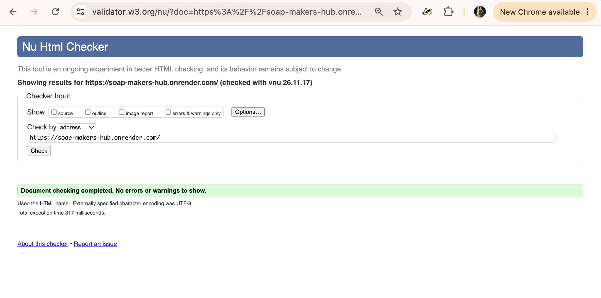
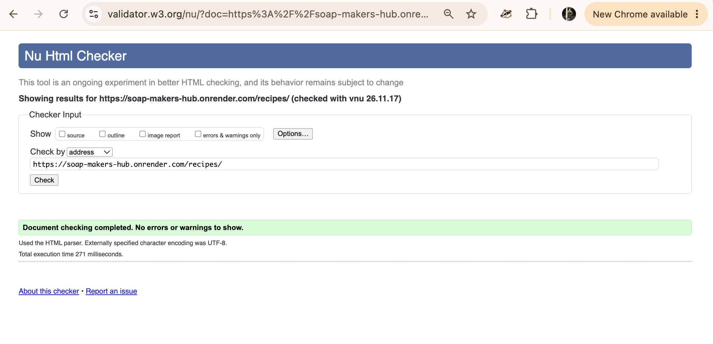
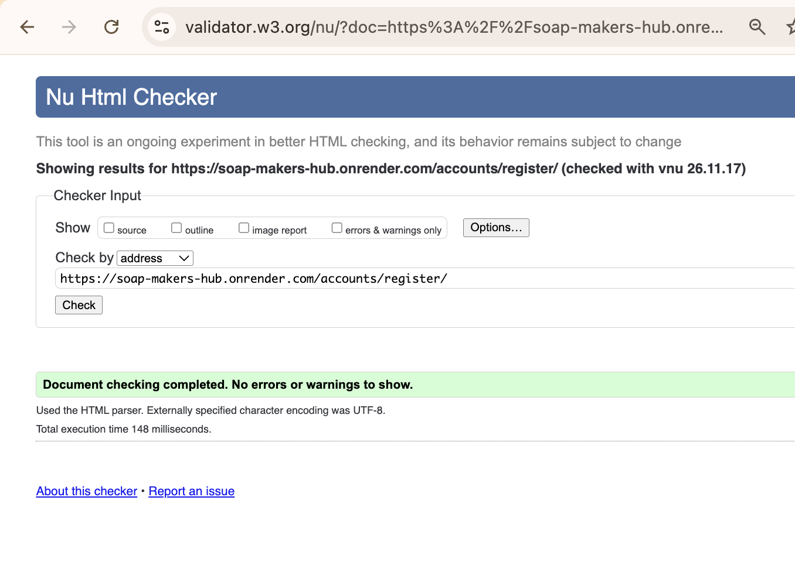
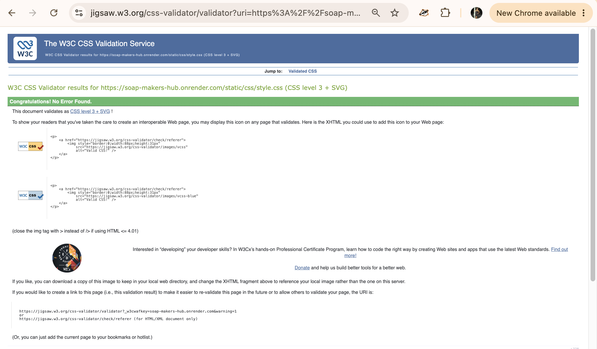
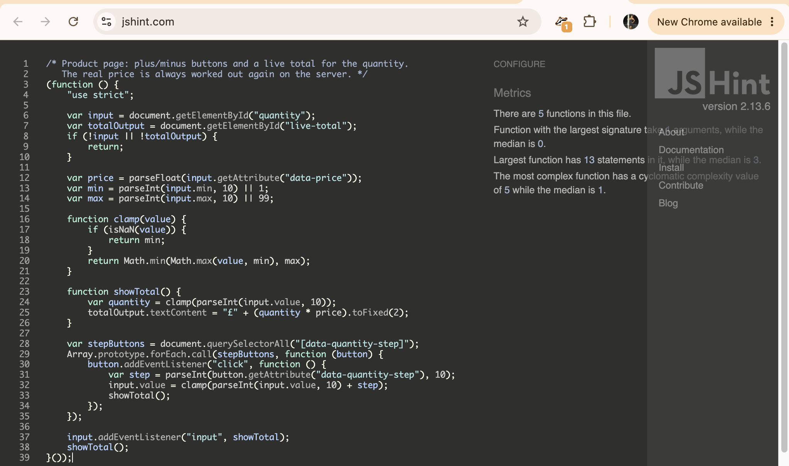
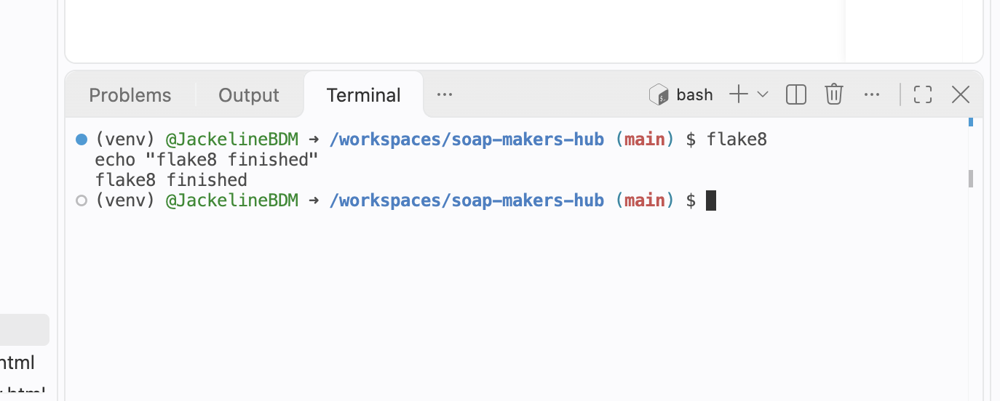

# Testing

Back to the [README](README.md).

## Automated tests

I wrote the tests first for reviews, order history, premium recipes and the 404 page. The git history shows a failing-test commit followed by a fix commit for each. Stripe is replaced with a fake in the tests, so no real payments are made. One extra test uses a genuinely signed Stripe event, which I added after the live webhook returned errors.

Run them with `python manage.py test`. Result: 59 tests, all passing.

Coverage (measured with `coverage run manage.py test` and `coverage report`): 1014 statements, 44 not run, **96% total**. The parts that are not covered are mostly settings for deployment and the `manage.py` start-up code.

| App | Main file | Coverage |
| --- | --- | --- |
| accounts | views.py, forms.py | 100% |
| shop | views.py | 92% |
| checkout | views.py | 91% |
| recipes | views.py | 86% |
| reviews | views.py | 94% |

## Code validation

| Check | Result | Evidence |
| --- | --- | --- |
| HTML (W3C) | No errors or warnings on the home, shop, recipes, login and register pages |      |
| CSS (W3C Jigsaw) | No errors |  |
| JavaScript (JSHint) | No warnings |   |
| Python (flake8) | No errors |  |
| Lighthouse mobile | Performance 93, Accessibility 95, Best Practices 100, SEO 91 |  |
| Lighthouse desktop | Performance 99, Accessibility 95, Best Practices 100, SEO 91 |  |

The W3C checker found two real problems, which I fixed: skipped heading levels on the shop page (changed `h5` to `h2` with the same look) and a bulleted list inside a paragraph on the register page (switched the form to `as_div`).

## Stripe webhook

After the first live test payments, Stripe reported 500 errors on the webhook. The code called `.get()` on a Stripe object, which the newer Stripe library does not allow. I fixed it, added a test with a signed event, and Stripe now shows 200 OK.

## Manual testing

Tested on the live site on 16 and 18 November 2026 in Chrome.

| Feature | Steps | Expected | Result |
| --- | --- | --- | --- |
| Register | Fill in the form | Account made, welcome message | Pass |
| Add to cart | Quantity 2, Add to cart | Cart shows 2 | Pass |
| Pay with a good card | 4242 4242 4242 4242 | Thank-you page and order number | Pass |
| Stripe webhook | Check Stripe after paying | Event delivered with status 200 | Pass |
| My orders | Open My orders | Only my own paid orders | Pass |
| Premium recipe locked | View as a customer | Unlock button, no ingredients | Pass |
| 404 page | Visit /nonsense/ | Home page with a message | Pass |
| Declined card | 4000 0000 0000 0002 | Friendly message, no paid order | Pass |
| Review: add | Rating and 10+ characters | Review shown | Pass |
| Review: edit and delete | Use the links | Each works with a message | Pass |
| Short review | Comment of 4 characters | Error message | Pass |
| Edit another user's review | Type its address | 403 page | Pass |
| Another user's order | Type its address | Not shown | Pass |
| Log in page when logged in | Visit /accounts/login/ | Redirected away | Pass |
| Mobile layout | 375px wide in DevTools | No sideways scroll, menu button works | Pass |

## Bugs found and fixed

| Bug | Cause | Fix |
| --- | --- | --- |
| Cart always added 1 item | The view ignored the quantity box | Added a quantity form, test first |
| Order could be marked paid without paying | The success page trusted the address | The server now asks Stripe whether the session is paid |
| Cloudinary upload failed on Render (Invalid Signature) | The CLOUDINARY_URL value contained placeholder text | Rebuilt it from the real key, secret and cloud name |
| Live shop was empty | The new Render database had no data | Added a seed command that loads starter products and recipes on deploy |
| Stripe webhook returned 500 | The code used `.get()` on a Stripe object | Used `session["payment_status"]` and added a signed-event test |
| Heading levels skipped on the shop page | Product names were `h5` directly under the page `h1` | Changed to `h2` with the `h5` look |
| Invalid HTML on the register page | Django's `as_p` put a list inside a paragraph | Used `as_div` |

## Known issues

None known.
