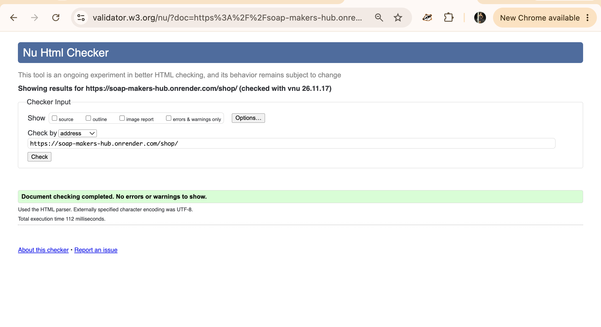
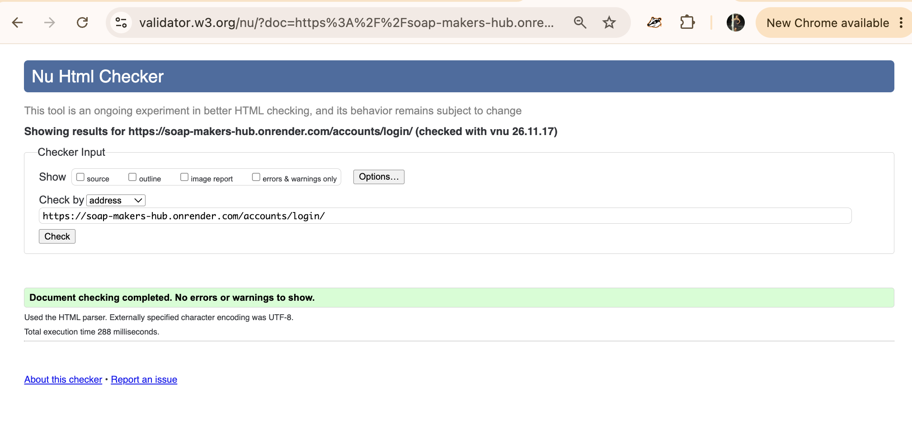
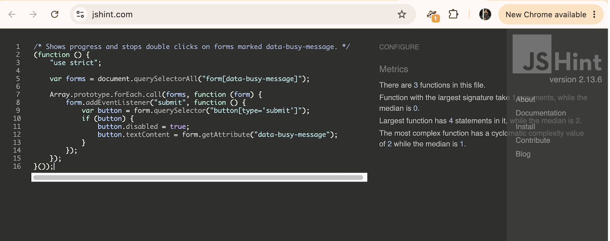
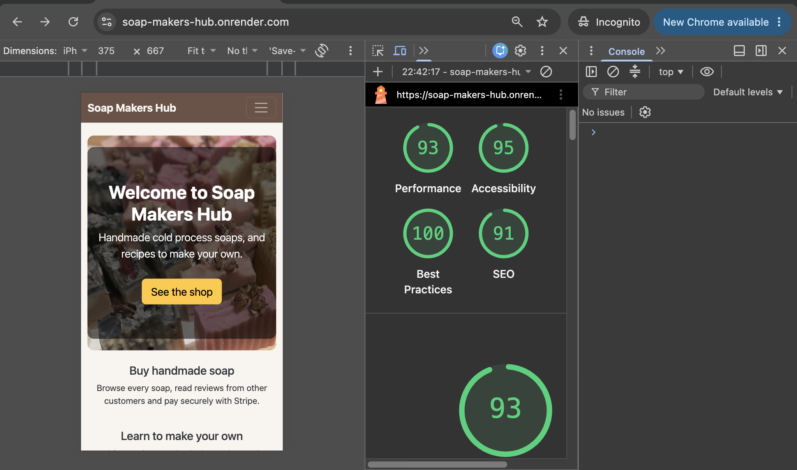
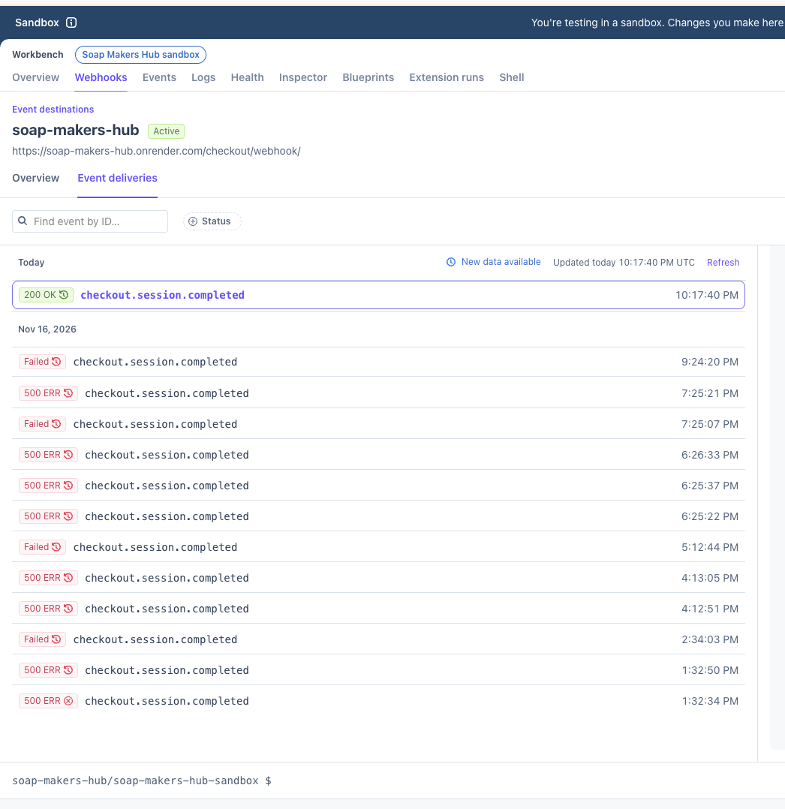

# Testing

Back to the [README](README.md).

## Contents

1. [Automated tests](#automated-tests)
2. [Code validation](#code-validation)
3. [Stripe webhook](#stripe-webhook)
4. [User stories tested](#user-stories-tested)
5. [Browsers and screen sizes](#browsers-and-screen-sizes)
6. [Manual testing](#manual-testing)
7. [Bugs found and fixed](#bugs-found-and-fixed)
8. [Known issues](#known-issues)

## Automated tests

I wrote the tests first for reviews, order history, premium recipes and the 404 page. The git history shows a failing-test commit followed by a fix commit for each. Stripe is replaced with a fake in the tests, so no real payments are made. One extra test uses a genuinely signed Stripe event, which I added after the live webhook returned errors.

Run them with `python manage.py test`. Result: 59 tests, all passing.

Coverage (measured with `coverage run manage.py test` and `coverage report`): 1014 statements, 44 not run, **96% total**. The parts that are not covered are mostly settings for deployment and the `manage.py` start-up code.

| App | Main file | Coverage |
| --- | --- | --- |
| accounts | views.py, forms.py | 100% |
| shop | views.py | 92% |
| checkout | views.py | 91% |
| recipes | views.py | 86% |
| reviews | views.py | 94% |

## Code validation

| Check | Result | Evidence |
| --- | --- | --- |
| HTML (W3C) | No errors or warnings on the home, shop, recipes, login and register pages |      |
| CSS (W3C Jigsaw) | No errors |  |
| JavaScript (JSHint) | No warnings |   |
| Python (flake8) | No errors |  |
| Lighthouse mobile | Performance 93, Accessibility 95, Best Practices 100, SEO 91 |  |
| Lighthouse desktop | Performance 99, Accessibility 100, Best Practices 100, SEO 91 |  |

The W3C checker found two real problems, which I fixed: skipped heading levels on the shop page (changed `h5` to `h2` with the same look) and a bulleted list inside a paragraph on the register page (switched the form to `as_div`).

## Stripe webhook

After the first live test payments, Stripe reported 500 errors on the webhook. The code called `.get()` on a Stripe object, which the newer Stripe library does not allow. I fixed it, added a test with a signed event, and Stripe now shows 200 OK.

## User stories tested

Each story from the [README](README.md#user-stories) was tested on the live site, and where it applies also by automated tests.

| # | User story | How I tested it | Result |
| --- | --- | --- | --- |
| 1 | Visitor: see all the soaps with photos and prices | Opened the shop page while logged out. All 3 soaps show a photo, name, description and price. | Pass |
| 2 | Visitor: read the free recipes | Logged out and opened a free recipe from the recipes page. The ingredients and method are shown. | Pass |
| 3 | Visitor: register and log in | Registered new users and logged in. Also checked that a logged-in user is sent away from the login page. Automated tests cover register, login and logout. | Pass |
| 4 | Customer: choose a quantity and see the total change | Used the plus and minus buttons on a product page and watched the total change. Added 2 of a soap and the cart showed 2. `product.js` passes JSHint. | Pass |
| 5 | Customer: pay by card with Stripe | Paid with the test card 4242 4242 4242 4242 and got the thank-you page and order number. Stripe delivered the webhook with status 200. | Pass |
| 6 | Customer: see my past orders | Opened My orders and saw only my own paid orders. A new user with no orders sees a message saying so. | Pass |
| 7 | Customer: write, edit and delete my own review | Added, edited and deleted a review and each showed a message. A comment of 4 characters was refused with an error message. | Pass |
| 8 | Customer: unlock a premium recipe | A premium recipe shows an unlock button and no ingredients until it is paid for. The automated premium recipe tests check the unlock. | Pass |
| 9 | Customer: get clear messages and error pages | Declined card (4000 0000 0000 0002) gave a friendly message and no paid order. A page that does not exist (/nonsense/) sends the visitor back to the site with a message. Another user's review gave the "not allowed" page. | Pass |
| 10 | Shop owner: add, edit and delete soaps, recipes and categories in the admin | Logged in to the Django admin. It lists Products, Recipes, Categories, Recipe purchases, Orders, Carts and Reviews, each with Add and Change links. | Pass |
| 11 | Shop owner: one account cannot change another person's data | Logged in as a second user, typed the address of another user's review edit page and got the "not allowed" page. A second user's My orders did not show the first user's orders. | Pass |

## Browsers and screen sizes

| Browser or size | What I checked | Result |
| --- | --- | --- |
| Chrome on a laptop (desktop) | Every test in this document, and the Lighthouse desktop run | Pass |
| Safari on a laptop (desktop) | Browsed the home page, shop, recipes, login and a page that does not exist. Layout, links and messages worked. | Pass |
| Chrome DevTools, tablet (768px wide) | Home, shop and product pages. The menu button opens the menu and the cards sit in a tidy grid with no sideways scroll. | Pass |
| Chrome DevTools, phone (375px wide) | Menu button works, one column of cards, no sideways scroll. Lighthouse mobile run. | Pass |

## Manual testing

Tested on the live site between 16 and 23 November 2026.

| Feature | Steps | Expected | Result |
| --- | --- | --- | --- |
| Register | Fill in the form | Account made, welcome message | Pass |
| Add to cart | Quantity 2, Add to cart | Cart shows 2 | Pass |
| Quantity buttons | Press plus on a product page | Total changes | Pass |
| Pay with a good card | 4242 4242 4242 4242 | Thank-you page and order number | Pass |
| Stripe webhook | Check Stripe after paying | Event delivered with status 200 | Pass |
| My orders | Open My orders | Only my own paid orders | Pass |
| Free recipe when logged out | Open a free recipe | Ingredients and method shown | Pass |
| Premium recipe locked | View as a customer | Unlock button, no ingredients | Pass |
| 404 page | Visit /nonsense/ | Back to the site with a message | Pass |
| Declined card | 4000 0000 0000 0002 | Friendly message, no paid order | Pass |
| Review: add | Rating and 10+ characters | Review shown | Pass |
| Review: edit and delete | Use the links | Each works with a message | Pass |
| Short review | Comment of 4 characters | Error message | Pass |
| Edit another user's review | Type its address | "Not allowed" page | Pass |
| Another user's order | Type its address | Not shown | Pass |
| Log in page when logged in | Visit /accounts/login/ | Redirected away | Pass |
| Mobile layout | 375px wide in DevTools | No sideways scroll, menu button works | Pass |

## Bugs found and fixed

| Bug | Cause | Fix |
| --- | --- | --- |
| Cart always added 1 item | The view ignored the quantity box | Added a quantity form, test first |
| Order could be marked paid without paying | The success page trusted the address | The server now asks Stripe whether the session is paid |
| Cloudinary upload failed on Render (Invalid Signature) | The CLOUDINARY_URL value contained placeholder text | Rebuilt it from the real key, secret and cloud name |
| Live shop was empty | The new Render database had no data | Added a seed command that loads starter products and recipes on deploy |
| Stripe webhook returned 500 | The code used `.get()` on a Stripe object | Used `session["payment_status"]` and added a signed-event test |
| Heading levels skipped on the shop page | Product names were `h5` directly under the page `h1` | Changed to `h2` with the `h5` look |
| Invalid HTML on the register page | Django's `as_p` put a list inside a paragraph | Used `as_div` |

## Known issues

- There is no "forgot password" email reset, because the site has no email service yet. This is listed under Future improvements in the README.
- In the Django admin, the Category list is labelled "Categorys". This is Django's automatic plural. It only shows to the shop owner in the admin and does not affect customers.
